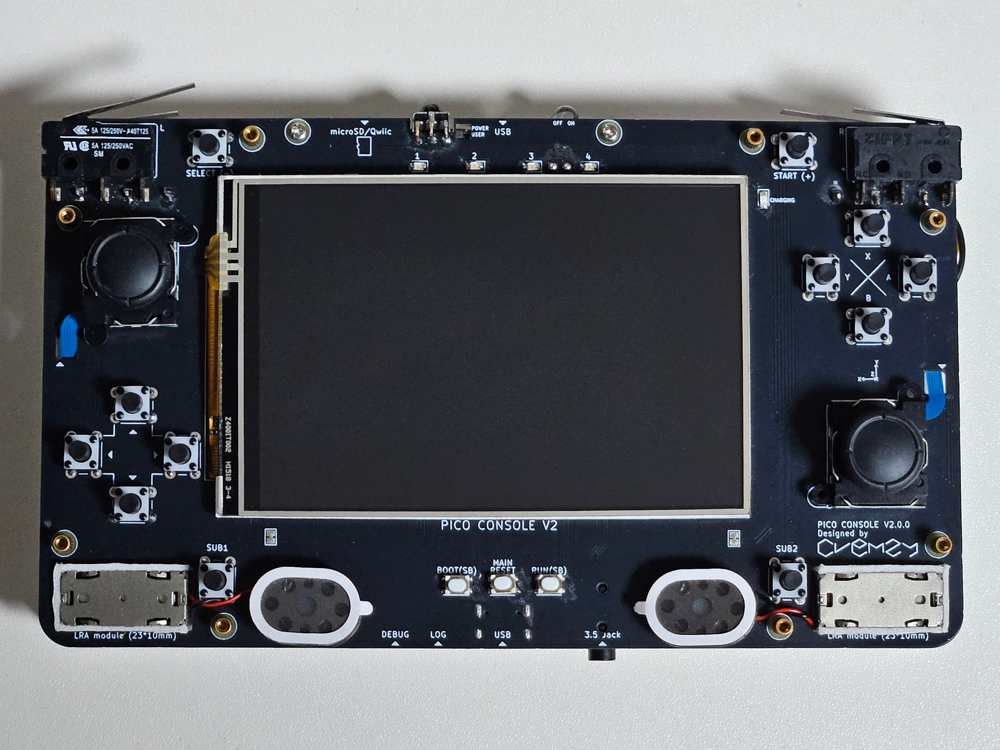
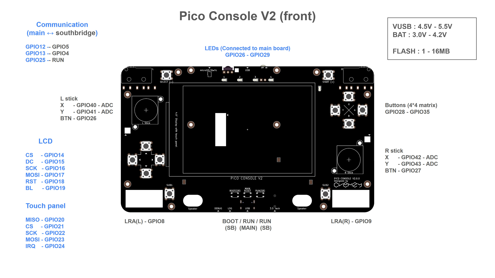
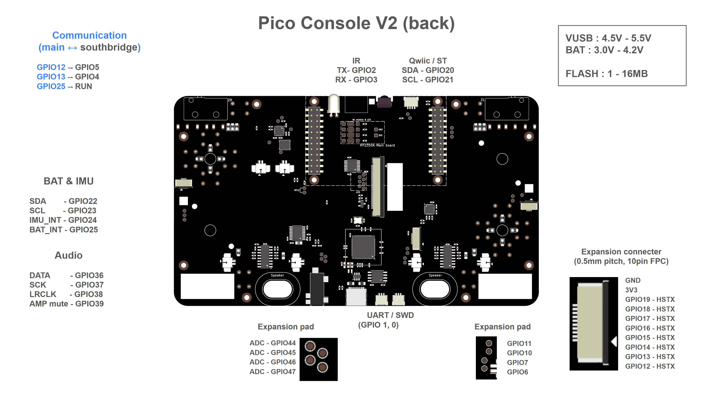
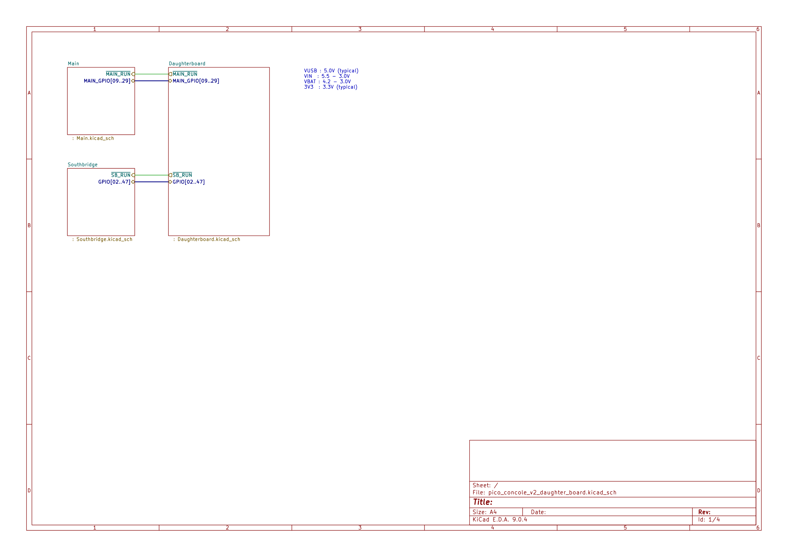
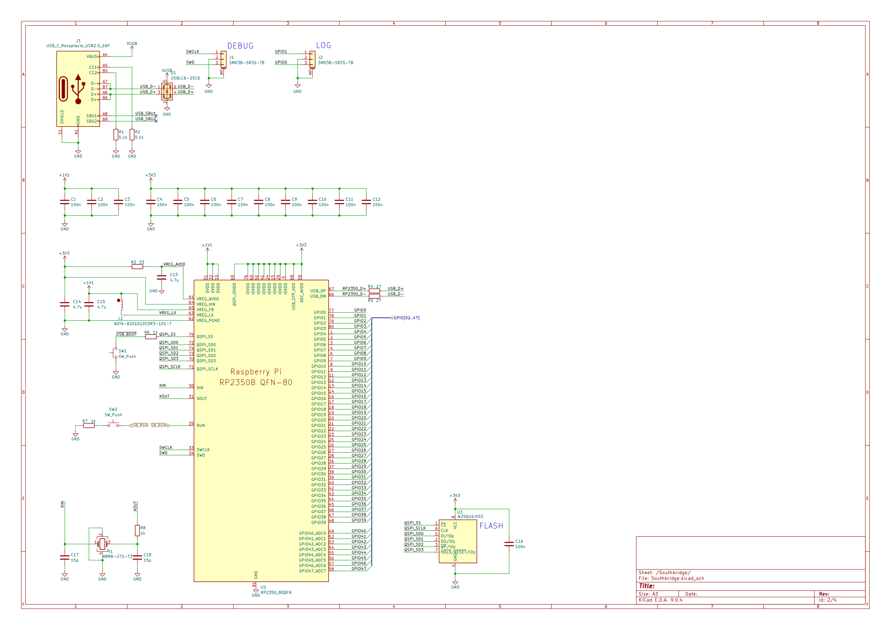
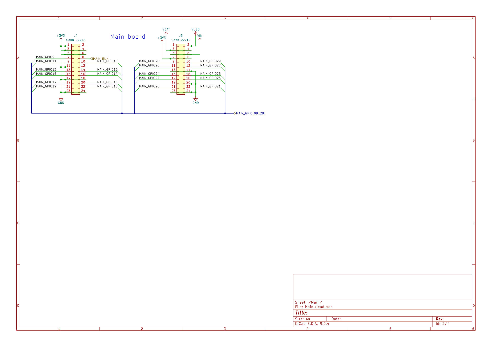
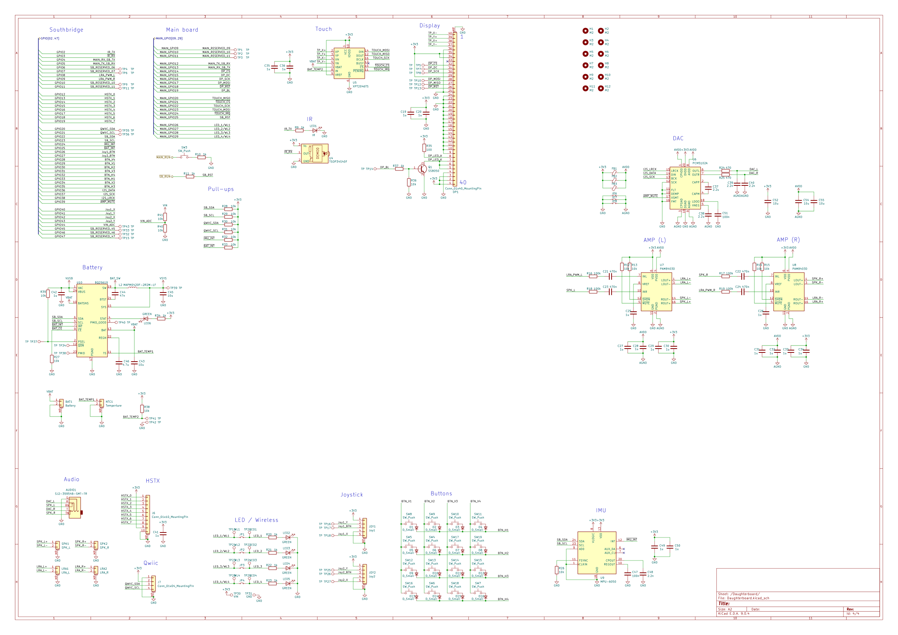
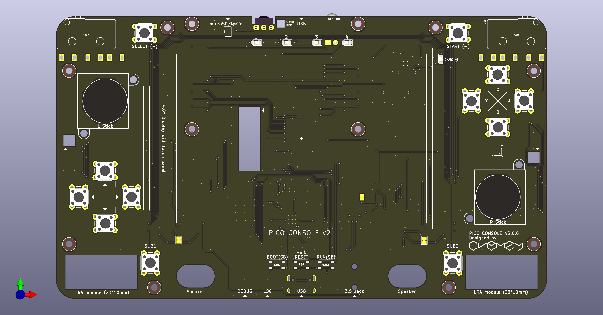
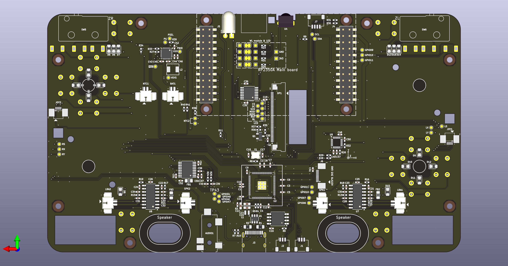

# Pico console V2 Board

A custom handheld console platform built around dual RP2350 microcontrollers, featuring a dedicated main processor and southbridge.

The board integrates a display, audio system, game controls, sensors, and external interfaces, with communication between the two MCUs.

**Note:** This board requires a separate [RP2350A Main Board](https://github.com/Crem2y/rp2350a_main_board) to operate.

## Specifications

- **Main MCU:** Raspberry Pi RP2350A
- **Southbridge MCU:** Raspberry Pi RP2350B
- **Flash:** 1-16 MB
- **Display:** 480x320 LCD with touch panel
- **Audio:** Stereo speakers, 3.5 mm audio jack
- **Controls:** Dual analog sticks, D-pad, face buttons, and additional function buttons
- **Sensors:** 6-axis IMU
- **Haptics:** Dual LRA actuators
- **Communication:** UART-based inter-MCU communication
- **External interfaces:** IR transceiver, Qwiic/ST connector
- **Expansion:** 10-pin FPC connector (0.5 mm pitch), additional GPIO/ADC pads
- **Power inputs:** VUSB (1.8-5.5 V), BAT (3.0-4.2 V)
- **Debug:** SWD interfaces

## Pinout

## Schematics

# PCB

## Design Files

- **EDA:** KiCad 9.0
- PCB design and schematic source files are available in this repository.